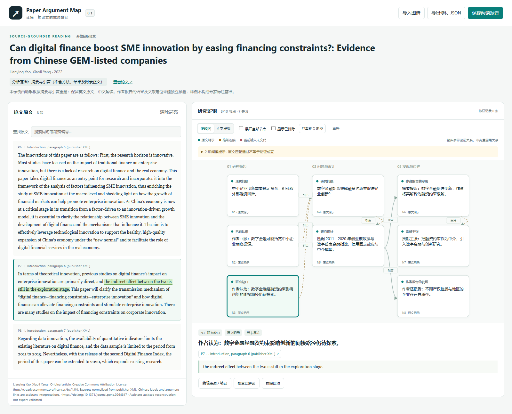

# Paper Argument Map

把论文引言中的**研究动机、研究缺口、方法与贡献**整理成可以回到原文核对的论证图。

当前版本：**0.1 · 研究原型**。面向金融／经济学实证论文，由 Codex Skill 生成解读，Python 工具检查来源并生成离线阅读报告。



## 现在可以做什么

- 对照英文原文阅读中文论证图；节点与关系都带来源。
- 区分原文明示、模型／读者推断，以及当前输入未交代的问题。
- 切换核心图、全部节点和同内容文字提纲。
- 点击段落反查对应的解读，或沿某一主张查看相关路径。
- 接受／排除解读、修改节点表述、添加笔记，并导出修订后的 JSON 或 HTML。
- 无网络依赖地打开生成的 HTML；报告自身不向服务器发送内容。

**边界：**这不是变量层面的因果 DAG，也不是科学真伪判定器。校验器验证结构、引用存在与原文匹配，不判断蕴含关系或识别设计是否有效。独立脚本不包含 LLM API；新的论文解读由运行 Skill 的助手完成。使用助手分析时，文本仍受所用平台的数据处理方式约束。

## 快速试用

需要 Python 3.10+，生成报告仅使用标准库，不需要安装 Python 依赖。

一次生成三个示例和入口页面：

```sh
python scripts/build_examples.py
```

然后打开 `outputs/index.html`。也可以只生成一篇：

```sh
python skills/paper-argument-map/scripts/paper_map.py render examples/01-digital-finance.argument.json --out outputs/digital-finance.html
```

用浏览器打开生成的 `outputs/digital-finance.html`。另有两个示例：

| 示例 | 主要阅读问题 | 原论文 |
|---|---|---|
| [数字金融与创新](examples/01-digital-finance.argument.json) | 融资约束为什么被当作中介？因果解释还需核对什么？ | [Yao & Yang, 2022](https://doi.org/10.1371/journal.pone.0264647) |
| [政府补贴与创新](examples/02-government-subsidies.argument.json) | 理论预期与报告结果方向如何不同？“未发现证据”意味着什么？ | [Li et al., 2021](https://doi.org/10.1371/journal.pone.0259642) |
| [国资参股与融资约束](examples/03-state-equity.argument.json) | 文献覆盖缺口、竞争机制与异质性如何相连？ | [Xiao, 2023](https://doi.org/10.1371/journal.pone.0292817) |

示例摘录来自 PLOS ONE 开放获取论文的摘要与引言，保留原作者、DOI 与 Creative Commons Attribution 许可说明。中文表述及关系是助手辅助重建，**未经独立专家标注，不是性能评测集**。示例的选择用于展示阅读交互，不代表对论文质量或结论的认可。

## 安装 Skill

```sh
python scripts/install_skill.py
```

安装到 `CODEX_HOME/skills/paper-argument-map`，未设置 `CODEX_HOME` 时使用 `~/.codex/skills/paper-argument-map`。若目标已存在，脚本拒绝覆盖。重新打开一个 Codex 对话后，用下面的请求试用：

> 使用 $paper-argument-map 分析这篇论文的摘要与引言，重点解释研究缺口、方法与贡献之间的联系。保留原文依据，标出模型推断和当前输入未说明的识别条件，生成可交互阅读报告。

附上论文文件、可访问链接，或粘贴文本。Skill 的使用不依赖 GitHub 连接。

## 数据与修订

[图谱格式](skills/paper-argument-map/references/graph-contract.md)说明节点、关系、联合前提及来源规则。所有分析依据都保存在 JSON 中。准备新输入可以使用：

```sh
python skills/paper-argument-map/scripts/paper_map.py prepare introduction.txt --title "Paper title" --scope "Introduction only" --out work/input.json
python skills/paper-argument-map/scripts/paper_map.py validate examples/01-digital-finance.argument.json
```

`prepare` 只分段，不执行论证分析。图谱由助手或人类按照格式补充，再校验与渲染。报告中的修改保存在当前页面内存中，必须使用**导出修订 JSON**或**保存阅读报告**下载保存；重新打开原文件不会自动带上未导出的修改。接受解读表示认可这项重建，而不是认证论文结论。

当前可在界面中修改表述、状态和笔记，接受／排除项目；新增节点、修改箭头端点或替换引文需编辑 JSON 或交给 Skill 处理。没有跨论文合并、后台重新推理、自动 PDF 高亮定位或模型置信度校准。

## 开发与验证

```sh
python -m unittest discover -s tests -v
```

浏览器交互测试需要 Playwright 与 Chromium：

```sh
npm install --no-save playwright
npx playwright install chromium
node tests/browser_smoke.cjs
```

测试涵盖不存在的来源、错误引文、联合前提、循环保留、HTML 注入防护、原文高亮、排除／恢复、编辑和导出后重开。技术测试不验证阅读收益，研究评估计划见 [docs/evaluation.md](docs/evaluation.md)。

原创代码和 Skill 使用 MIT 许可；论文摘录保留各自的 CC BY 许可。
